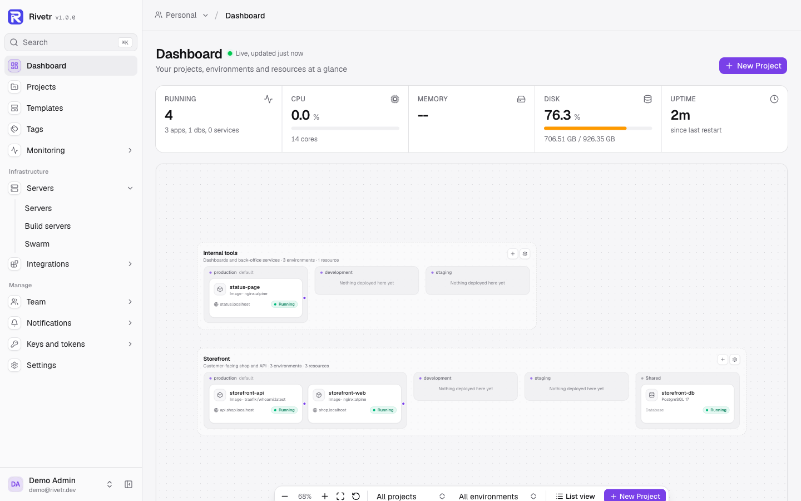
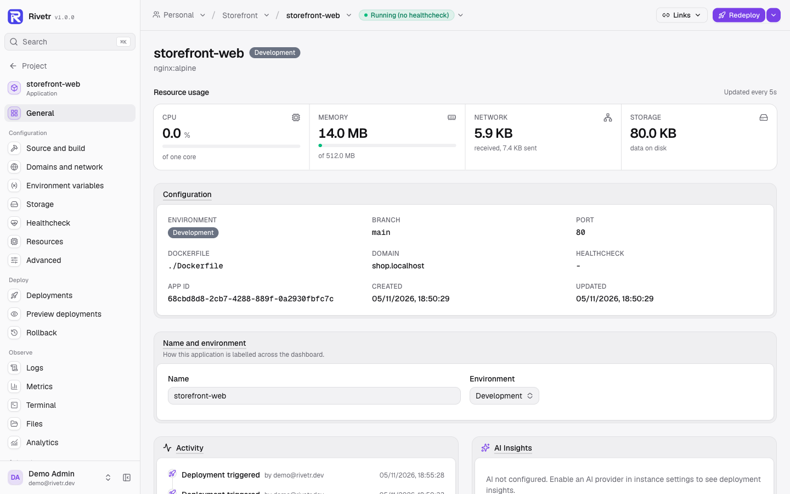
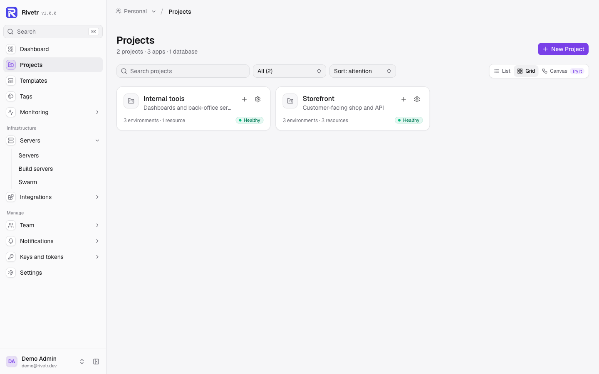
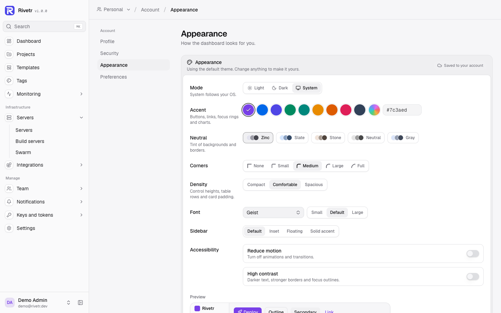

<p align="center">
  
</p>

# Rivetr

Deploy applications from Git with a single binary and no external services.

[](LICENSE)
[](https://www.rust-lang.org/)
[](https://github.com/KwaminaWhyte/rivetr/actions)
[](https://hub.xerj.org/contributors/KwaminaWhyte)





<p>
  
  
</p>

## What is Rivetr?

Rivetr is a self-hosted PaaS (Platform as a Service) that deploys applications from Git with minimal resource usage. It ships as a single binary with an embedded SQLite database, an embedded reverse proxy with automatic HTTPS, and a React dashboard: no Redis, no PostgreSQL, no Traefik required. It needs only Docker or Podman on the host.

It handles webhooks from GitHub, GitLab, Gitea, Bitbucket and Docker Hub, and provides zero-downtime deployments with health checks and automatic rollback.

Measured on Rivetr 1.0.0, Ubuntu 24.04 x86_64: the Rivetr process uses 52 MB RSS (8 threads) while managing 30 containers; the release binary is 47 MB.

## Why Rivetr?

| | Rivetr | Coolify | Dokploy |
|---|---|---|---|
| **Control plane memory** | 52 MB RSS, measured with 30 containers | No published figure; docs ask for 2 GB RAM | No published figure; docs ask for 2 GB RAM |
| **Services it runs** | None besides the binary | PostgreSQL, Redis, Traefik or Caddy | PostgreSQL, Traefik (on Docker Swarm) |
| **Single binary** | Yes | No | No |
| **Container runtimes** | Docker, Podman | Docker | Docker |
| **Git providers** | GitHub, GitLab, Gitea, Bitbucket, any Git URL | GitHub, GitLab, Gitea, Bitbucket, any Git URL | GitHub, GitLab, Gitea, Bitbucket, any Git URL |
| **Preview deployments** | Yes (all four providers) | Yes (all four providers) | Yes (GitHub only) |
| **MCP server** | Built in | Built in | Separate package (`@dokploy/mcp`) |
| **Terminal UI (TUI)** | Yes | No (CLI only) | No (CLI only) |
| **File browser** | Containers and remote servers | Containers (beta) | No |
| **License** | MIT | Apache 2.0 | Apache 2.0, with source-available `/proprietary` features |

Competitor details checked against their docs and releases on 2026-11-05 (Coolify v4.6.0, Dokploy v0.31.0).

## Features

### Core Deployment

- Git deployments from GitHub, GitLab, Gitea, and Bitbucket with webhook signature verification
- Build types: Dockerfile, Nixpacks, Railpack, Cloud Native Buildpacks (Paketo or Heroku builders), static sites, or a prebuilt Docker image
- Docker and Podman runtime with automatic detection
- Zero-downtime deployments: clone → build → start → health check → atomic proxy switch, then the old container is drained of in-flight requests
- Automatic rollback on health check failure
- Structured health checks: HTTP or command, expected status code and body, timing
- Preview deployments for pull requests (unique subdomain per PR, auto-cleaned on close/merge)
- Deploy by specific commit SHA or git tag
- Container replicas with round-robin load balancing
- ZIP file upload as an alternative to Git
- Deployment queue cancellation: cancel any queued or running deployment mid-flight
- Clone an app, database or service to another server, project or environment, optionally with volume data

### Platform Services

- Managed databases: PostgreSQL, MySQL, MariaDB, MongoDB, Redis, DragonflyDB, KeyDB, ClickHouse, LibSQL (one-click provisioning)
- Docker Compose multi-container deployments with optional raw mode (skip Rivetr network injection)
- Service deployments: Deploy button with recorded history and live logs, build images from git or a server path and push to a registry, pre/post-deploy hooks (for example migrations), rollback by image digest, per-container logs/restart/terminal, encrypted env vars written to a managed `.env` (see [docs/reference/service-deployments.md](docs/reference/service-deployments.md))
- 365 pre-configured service templates across categories: AI/ML, Analytics, Automation, CMS, Communication, Dev Tools, Documentation, File/Media, Monitoring, Security, Search, Project Management, and more
- Community template submissions: anyone can submit a Docker Compose template from the Templates page; an instance admin approves or rejects it before it appears in the catalogue marked Community
- Scheduled jobs: cron-based command execution inside running containers
- Scheduled container restarts: cron-based restarts through the normal restart path (zero-downtime swap, replicas, every server of a multi-server app), with run history, skipped runs recorded and a notification when a run fails
- AI-generated Docker Compose from a plain-language description

### Team Collaboration

- Teams, with apps, databases, services, projects and servers scoped to a team
- Role presets owner, admin, developer, deployer and viewer, built from 24 fine-grained abilities (for example `apps.deploy`, `env.read_secrets`, `team.manage`)
- Custom roles per team, built from those abilities (no one can grant abilities their own role lacks)
- Per-member resource overrides on apps, databases, services and projects: deny removes access, allow grants read, deploy and edit; deny wins over allow
- Per-team 2FA requirement: members without TOTP or a passkey are refused the team's resources (`two_factor_required`) until they set one up
- Team invitations via email with 7-day expiry
- Audit log of user and team actions
- App sharing between teams (view-only shares cannot write)

### Security and Authentication

- Automatic HTTPS with Let's Encrypt and auto-renewal
- OAuth login: GitHub, Google, GitLab, Microsoft (Azure), Bitbucket
- SSO with any OpenID Connect provider (for example Auth0, Keycloak, Azure AD, Okta)
- TOTP-based 2FA with recovery codes
- Passkey sign-in
- AES-256-GCM encryption for secrets and SSH keys at rest
- Personal API tokens for CI/CD and scripts (prefixed `rvt_`, stored as SHA-256 hashes): scopes `read`, `deploy`, `write`, `delete`, `secrets`, `admin` enforced on every API route and MCP tool, optional restriction to a team or projects, optional expiry, pause and resume, roll with a grace period, last use time and IP. A token never exceeds its owner's permissions.
- API access policy for tokens (on/off and IP allowlist)
- Rate limiting on API, webhook, and auth endpoints
- Strict input validation and security headers

### CI/CD

- Deployment approval workflow: require sign-off before a deploy goes live
- Deployment freeze windows: block deploys during maintenance periods from every trigger (dashboard, API, Git and Docker Hub webhooks, scheduled deploys, deploy by commit or tag); preview deploys are exempt unless the window opts in, and a blocked webhook deploy is recorded as frozen
- Scheduled deployments: trigger a deploy at a specific date and time
- DockerHub webhook: auto-deploy when a new image is pushed
- Watch paths: only trigger a deploy when specific file paths change in a push
- Container resource limits: set CPU and memory limits per app, apply live via `docker update` (no redeploy)

### Operations and Monitoring

- Real-time log streaming via WebSocket and SSE
- Deployment log search with configurable per-app retention policies
- Uptime tracking and response time monitoring via health check latency
- Container crash recovery with exponential backoff and configurable restart limits
- Traffic analytics per app, server and team, with optional GeoIP country breakdown
- Prometheus `/metrics` endpoint for external monitoring
- Webhook event log
- Recharts-powered dashboard for CPU, memory, and deployment history

### Developer Experience

- Modern React + TypeScript dashboard using shadcn/ui components
- Projects canvas: zoomable view of projects, environments and resources with live status
- Theme customisation per user: mode, accent colour, radius, density, font
- Tags for organising resources
- Container file browser for apps, databases and services
- Browser-based terminal for running containers and remote servers (SSH)
- Remote filesystem browser: browse, read, write, and delete files on any registered server over SSH
- Terminal UI (`rivetr tui`, built with `--features tui`): keyboard-driven dashboard for managing apps, deployments, and servers from any terminal
- Environment variables with AES-256-GCM encrypted storage
- Shared env vars with inheritance: team → project → environment → app
- Service dependency graph
- Config snapshots: save and restore full app configuration
- Export and import projects as JSON
- MCP server for AI assistant integration (can be turned off in Settings)

### Backup and Storage

- Managed database backups: manual or scheduled (hourly, daily, weekly) with a retention count, kept on the Rivetr host and optionally copied to S3-compatible storage (AWS S3, MinIO, Cloudflare R2, or any custom endpoint) with the same retention in the bucket
- Volume backups: manual or on a cron schedule, to local disk or S3, live (read-only helper container) or with the app stopped for a consistent copy, with a retention count and run history
- Full instance backup: SQLite database + config + SSL certificates as a single archive, manual or on a cron schedule, local and optionally S3, pruned by `retention_days`
- One-click restore of database, volume and instance backups from local disk or S3; S3 downloads are checked against the stored size and SHA-256, and a safety backup of the current data is taken first
- Backup notifications on every channel: succeeded, failed, and missed scheduled runs

See [docs/reference/backups.md](docs/reference/backups.md).

### Multi-Server and Scale

- Multi-server support: register and deploy to remote servers via SSH, including non-root users with passwordless sudo and Tailscale connectivity
- Remote server browser-based terminal and filesystem browser
- Server maintenance: Docker image list with reclaimable space, scheduled Docker cleanup, OS patching with automatic security updates
- Docker Swarm: init swarm, manage nodes, scale services, advanced service spec
- Build servers: offload builds to dedicated remote nodes
- Container registry push after build
- Log draining: Axiom, New Relic, Datadog, Logtail, or any HTTP endpoint
- Ansible playbook (`ansible/rivetr.yml`) for automated server provisioning on Ubuntu/Debian

## Terminal UI (TUI)

Rivetr ships with an optional keyboard-driven terminal dashboard built with [ratatui](https://ratatui.rs/). It connects to any running Rivetr instance, local or remote, without opening a browser.

### Using the TUI from your local machine

**Prerequisites:** A running Rivetr instance (e.g. `https://rivetr.example.com`) and an API token from **Keys → API Tokens**.

The TUI is behind the `tui` Cargo feature. Release binaries are built without it, so build from source:

```bash
git clone https://github.com/KwaminaWhyte/rivetr.git
cd rivetr
cargo build --release --features tui
./target/release/rivetr tui --url https://rivetr.example.com --token rvt_your_token_here
```

**Using environment variables (avoids typing the token every time):**

```bash
export RIVETR_URL=https://rivetr.example.com
export RIVETR_TOKEN=rvt_your_token_here
./target/release/rivetr tui
```

### Keyboard shortcuts

| Key | Action |
|-----|--------|
| `Tab` / `Shift-Tab` (or `→` / `←`) | Switch between Apps / Deployments / Servers / Logs tabs |
| `↑` / `↓` (or `k` / `j`) | Navigate list |
| `Enter` | Select |
| `d` | Deploy selected app |
| `s` | Stop selected app |
| `r` | Restart selected app |
| `R` | Refresh now |
| `?` | Toggle help overlay |
| `q` / `Esc` / `Ctrl-C` | Quit |

Data refreshes automatically every 5 seconds.

---

## Quick Start

### One-Line Install (Production)

```bash
curl -fsSL https://raw.githubusercontent.com/KwaminaWhyte/rivetr/main/install.sh | sudo bash
```

It installs Docker if needed, build tools (Nixpacks, Railpack, Pack), the latest Rivetr binary from GitHub Releases (or builds from source if the download fails), a systemd service and a config with a generated admin token. Then open `http://your-server-ip:8080` and create your admin account.

Manual install, upgrades, backups and troubleshooting: [DEPLOYMENT.md](DEPLOYMENT.md).

### Development Setup

See [CONTRIBUTING.md](CONTRIBUTING.md#development-setup). Prerequisites: Rust 1.95+, Node.js 22.22+, Docker or Podman.

## Configuration

Server settings live in `rivetr.toml`. A minimal production file:

```toml
[server]
api_port = 8080
data_dir = "/var/lib/rivetr"

[auth]
admin_token = "change-me-in-production"

[proxy]
acme_email = "admin@example.com"
# base_domain = "apps.example.com"  # enables *.apps.example.com subdomains
```

Every key is documented in [docs/reference/configuration.md](docs/reference/configuration.md); [`rivetr.example.toml`](rivetr.example.toml) is a copyable starter. Per-app settings (build type, health check, resources, domains, env vars) are managed from the dashboard or API.

## CLI Reference

The same binary is also a CLI. `status`, `apps`, `deploy` and `logs` talk to a running instance over its API, from any machine:

```bash
# Check instance health and version (--api-url and --token go before the subcommand)
rivetr --api-url https://rivetr.example.com --token rvt_… status

# List apps
rivetr apps list

# Trigger a deployment
rivetr deploy my-app

# Stream live logs
rivetr logs my-app --follow

# Launch the terminal dashboard (needs a build with --features tui)
rivetr tui --url https://rivetr.example.com --token rvt_…
```

`RIVETR_API_URL` and `RIVETR_TOKEN` can replace `--api-url` and `--token`. `tui` reads `RIVETR_URL` instead of `RIVETR_API_URL`.

These run on the server itself and read its `rivetr.toml` (pass `--config` if it is not in the current directory):

```bash
# Backup and restore the instance
rivetr --config /opt/rivetr/rivetr.toml backup --output ./my-backup.tar.gz
rivetr --config /opt/rivetr/rivetr.toml restore ./my-backup.tar.gz

# Offline admin recovery and maintenance
rivetr reset-password admin@example.com
rivetr config check
rivetr db encrypt-secrets
```

## Project Structure

See [docs/architecture/architecture.md](docs/architecture/architecture.md#source-layout) for the source layout and how the components fit together.

## Requirements

- **OS**: Linux (x86_64 or aarch64) for production; macOS and Windows for development
- **Runtime**: Docker Engine or Podman
- **Ports**: 80 (HTTP proxy), 443 (HTTPS proxy), 8080 (API and dashboard)
- **Build from source**: Rust 1.95+, Node.js 22.22+

## Contributing

Contributions are welcome. See [CONTRIBUTING.md](CONTRIBUTING.md) for development setup, code style, and the PR checklist.

## Documentation

| Document | Description |
|---|---|
| [CONTRIBUTING.md](CONTRIBUTING.md) | Development setup, code style, PR process |
| [DEPLOYMENT.md](DEPLOYMENT.md) | Production install, upgrades, backup, troubleshooting |
| [CHANGELOG.md](CHANGELOG.md) | Version history and release notes |
| [ROADMAP.md](ROADMAP.md) | Open work and where it is tracked |
| [docs/architecture/architecture.md](docs/architecture/architecture.md) | System design, source layout and tech stack |
| [docs/reference/configuration.md](docs/reference/configuration.md) | Every `rivetr.toml` key |
| [docs/reference/remote-servers.md](docs/reference/remote-servers.md) | Remote servers: adding, non-root sudo, Tailscale |
| [docs/reference/service-templates.md](docs/reference/service-templates.md) | Catalogue of all 365 service templates by category |
| [docs/reference/service-deployments.md](docs/reference/service-deployments.md) | Deploying, building, hooks, rollback and env for Docker Compose services |
| [docs/research/competitive-gap-analysis.md](docs/research/competitive-gap-analysis.md) | Open gaps against Coolify, Dokploy and others (Nov 2026) |
| [ansible/rivetr.yml](ansible/rivetr.yml) | Ansible playbook for automated server provisioning |
| [live-testing/TESTING-GUIDE.md](live-testing/TESTING-GUIDE.md) | Manual testing procedures |

## License

MIT, see [LICENSE](LICENSE) for details.
